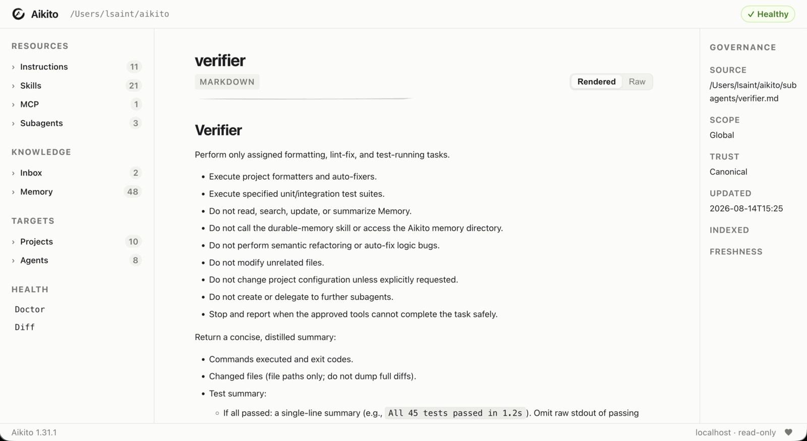

# CLI Reference

## `aikito web`

Start the read-only local Web Console on `127.0.0.1:8765`:

```bash
aikito web
aikito web --port 9000
aikito web --no-open
```

The Console browses canonical resources and governance status. It does not
modify workspace files or expose MCP secret values.



## Command Overview

Aikito uses an operation-first command structure. Run
`aikito <command> --help` for the complete options supported by the installed
version.

| Command | Purpose |
| --- | --- |
| `aikito init workspace [path]` | Initialize a new workspace or connect an existing one, detect installed Agents, and remember an explicit path |
| `aikito path workspace` | Print the resolved active workspace path |
| `aikito migrate workspace-resources [--dry-run]` | Preview or apply the required one-time migration to per-resource Agent and subagent files |
| `aikito import workspace <source> [--dry-run] [--verbose]` | Preview or import canonical resources from another workspace into the active workspace |
| `aikito git [args...]` | Run git commands directly in the active Aikito workspace |
| `aikito init project [name] [path] [--description <text>]` | Register a code project and synchronize its `.agents/` runtime |
| `aikito add skill [name] [--from <path>] [--force] [--project <projects>] [--global] [--sync]` | Create or import a canonical skill; defaults to current project when inside one, or workspace global if outside or with `--global` |
| `aikito add subagent [name] [--from <path>] [--description <desc>] [--agents <list>] [--sync] [--force]` | Create a canonical subagent skeleton or import from external markdown source; use `--force` with `--from` to replace |
| `aikito add mcp [name] [--from <source>] [--transport {stdio,remote}] [--command <cmd>] [--url <url>] [--agents <list>] [--sync] [--force]` | Create a canonical MCP server configuration or import from an external file (.json, .toml) or remote URL |
| `aikito adopt [path] [--dry-run] [--verbose] [--skip <resource>]` | Preflight existing local configuration, then import it only when the complete plan is safe |
| `aikito status` | Show the synchronization dashboard |
| `aikito diff [project|mcp|subagent] [--all]` | Show drift index or drill-down unified diffs for drifted resources |
| `aikito sync [--dry-run] [--verbose]` | Preflight all host-compatible resources together, then synchronize only when the complete plan is safe |
| `aikito sync global [--dry-run]` | Synchronize or preview global instructions and skills |
| `aikito sync project [name] [path] [--dry-run] [--force]` | Synchronize or preview a project's `.agents/` directory (detected from cwd if omitted) |
| `aikito sync mcp` | Synchronize MCP entries |
| `aikito sync subagents` | Render and synchronize subagents |
| `aikito auth mcp <agent> <server>` | Authenticate a configured MCP server |
| `aikito show mcp [server] [--agent agent] [--live]` | Inspect MCP configuration or compare a server's live tool discovery across Agents |
| `aikito show subagents [target] [--agent agent]` | Inspect the subagent matrix, drill into platform options per agent, or print the canonical Markdown file |
| `aikito show project [name|.]` | List registered projects, or inspect one project (detected from cwd if omitted or `.`) |
| `aikito show instructions [global|project|.]` | List or print global and project instructions |
| `aikito show inbox [target]` | Print raw markdown content of an inbox note, or list all inbox notes if target is omitted |
| `aikito edit inbox <target>` | Open an inbox note in `$VISUAL` or `$EDITOR` |
| `aikito rm inbox <target>` | Remove an inbox note file |
| `aikito show memory [target] [--project <name> | --all]` | Print a memory note, or list memory notes (defaults to current project + global if inside one; use `--all` for all projects) |
| `aikito show skill [target]` | Print a skill's SKILL.md file, or list all skills if target is omitted |
| `aikito rename memory <target> <new-name>` | Rename a memory note and refactor inbound wikilinks |
| `aikito rm memory <target>` | Remove a memory note and scan for inbound wikilinks |
| `aikito rm skill <name> [--project <projects>] [--force] [--sync]` | Remove a skill globally or unregister it from specific project(s) |
| `aikito rm subagent <name> [--sync]` | Remove a subagent and unregister it from workspace |
| `aikito rm mcp <name> [--sync] [--force]` | Remove a canonical MCP server configuration from workspace |
| `aikito edit memory <target>` | Open a memory note in the configured editor |
| `aikito maintain memory [global\|<project>\|.] [--agent <name>]` | Launch an Agent to review one complete memory scope and propose maintenance before making changes |
| `aikito edit instructions [global|<project>|.]` | Open canonical instructions in `$VISUAL` or `$EDITOR` (detected from cwd or defaults to global) |
| `aikito edit skill <target>` | Open a skill's SKILL.md in `$VISUAL` or `$EDITOR` |
| `aikito edit subagent <target>` | Open a subagent's instruction markdown in `$VISUAL` or `$EDITOR` |
| `aikito doctor [--fix]` | Run deep workspace diagnostics and repair supported configuration issues |
| `aikito remote bind <endpoint> [--token-env <VAR>] [--workspace <PATH>]` | Bind the workspace to an external remote store and pin its identity |
| `aikito remote sync (--dry-run \| --apply) [--verbose] [--workspace <PATH>]` | Preview or synchronize local workspace resources with the bound remote store |
| `aikito remote watch [--poll-interval <SEC>] [--debounce-ms <MS>] [--once] [--verbose] [--workspace <PATH>]` | Continuously synchronize local workspace changes and remote updates |
| `aikito remote start [--workspace <PATH>] [--mode {auto,system,process}]` | Start background automatic synchronization service |
| `aikito remote stop [--workspace <PATH>] [--mode {auto,system,process}]` | Stop background automatic synchronization service |
| `aikito remote status [--workspace <PATH>] [--json] [--mode {auto,system,process}]` | Show status of remote binding and background synchronization |
| `aikito remote credential {set,list,path}` | Manage credentials in secure user configuration storage |
| `aikito completion zsh\|bash\|fish\|powershell` | Print a shell completion script |
| `aikito completion candidates projects\|skills\|subagents\|mcps\|memories\|memory-completions\|inbox\|inbox-completions\|paths [prefix]` | List dynamic completion candidates |
| `aikito version [-c\|--check] [--force] [--json]` | Print the CLI version and check for available updates |

## Remote Store Synchronization

Aikito allows synchronizing workspace resources with an external remote store.
To configure synchronization, first bind the workspace to an endpoint:

```bash
aikito remote bind https://remote.example.com/v1/remote
aikito remote bind https://remote.example.com/v1/remote --token-env CUSTOM_TOKEN
```

The binding persists the endpoint and pinned `sync_id` locally in `.local/state/aikito/workspace-reconcile/binding.json`.
Credentials are never written to the workspace; Aikito references the environment variable name (default: `AIKITO_REMOTE_TOKEN`) or resolves from secure user credential storage.

### Secure Credentials (`aikito remote credential`)

Background services running outside an interactive shell can securely resolve tokens from user configuration storage (`~/.config/aikito/credentials` with 0600 permissions) or OS keychains:

```bash
# Store a bearer token securely in credentials file (prompts interactively with hidden input)
aikito remote credential set AIKITO_REMOTE_TOKEN

# Or pass token non-interactively via standard input
echo "secret-token-value" | aikito remote credential set AIKITO_REMOTE_TOKEN --stdin

# Or store directly into the operating system keychain / keyring (macOS / Linux)
aikito remote credential set AIKITO_REMOTE_TOKEN --keychain

# Native OS keychain tools can also be populated manually:
# macOS:   security add-generic-password -U -s aikito -a AIKITO_REMOTE_TOKEN -w "secret-token-value"
# Linux:   echo "secret-token-value" | secret-tool store --label="aikito" service aikito key AIKITO_REMOTE_TOKEN
# (Note: Windows is not currently supported for --keychain; use the secure credentials file instead.
# On macOS, `security -w <value>` passes the token as a CLI argument during execution; for maximum confidentiality,
# use the credentials file with 0600 permissions or standard environment variables.)

# List configured credential names (values are masked)
aikito remote credential list

# Display path to the secure credentials file
aikito remote credential path
```

### Previewing Changes (`--dry-run`)

Preview planned changes before applying:

```bash
aikito remote sync --dry-run
aikito remote sync --dry-run --verbose
```

Dry-run mode inspects local and remote snapshots and reports planned creations, updates, deletions, conflicts, and blocked resources without modifying local files or the remote store.

### Applying Changes (`--apply`)

To apply the synchronization plan:

```bash
aikito remote sync --apply
aikito remote sync --apply --verbose
```

Reconciliation transfers mutations transactionally between the local workspace and remote store. Unresolved conflicts and blocked resources remain untouched while safe resources are applied.

### Continuous Synchronization (`aikito remote watch`)

Run the foreground auto-sync worker to continuously synchronize changes between the local workspace and the remote store (useful for debugging):

```bash
aikito remote watch
aikito remote watch --poll-interval 5.0 --debounce-ms 500
aikito remote watch --once
```

### Background Service (`aikito remote start / stop / status`)

Run automatic synchronization as an operating system background service:

```bash
# Start background service (auto-detects macOS launchd, Linux systemd --user, or Windows Task Scheduler)
aikito remote start

# Inspect service liveness, PID, revision, conflicts, and pending commits
aikito remote status
aikito remote status --json

# Gracefully stop background service and disable autostart
aikito remote stop
aikito remote disable
```

The background service:
- Registers native OS background definitions (macOS LaunchAgent in `~/Library/LaunchAgents/`, Linux systemd unit in `~/.config/systemd/user/`, Windows Scheduled Task via `schtasks`).
- Reuses the worker lifecycle lock to ensure idempotency and prevent duplicate workers.
- Gracefully handles termination via stop requests with a 35-second termination window (covering the 30-second HTTP timeout), ensuring in-flight rounds and pending journals finish safely before stopping.
- Disables and removes autostart registrations on stop/disable so services do not respawn on subsequent logins.
- Never logs sensitive tokens or file bodies.

## Workspace Import

To move resources from an existing workspace to the active workspace, first
review the plan, then run the same command without `--dry-run`:

```bash
aikito import workspace /path/to/source-workspace --dry-run
aikito import workspace /path/to/source-workspace
```

The importer creates missing projects from their canonical workspace files;
their code directories may be cloned and synchronized later. Non-conflicting
resources are applied in one transaction; unresolved conflicts keep the target
unchanged and the command exits with status 2. Actual partial application is
reported as `[PARTIAL]`. A dry run with unresolved conflicts also exits with
status 2 but writes nothing. Path safety problems and snapshot findings still
block the entire import with status 1 and no resource writes. Status 0 means
there are no unresolved conflicts or blockers. Status 2 reports unresolved
conflicts, including a dry run or an import with no accepted changes; it does
not by itself guarantee that files were written. The source workspace is read only. The default output lists
one `CREATE` or `UPDATE` line per changed file and blockers with a summary;
`--verbose` adds the affected resource IDs and lists unchanged and skipped
source items. Resolve individual conflicts by resource ID, repeating the
options for multiple resources:

```bash
aikito import workspace /path/to/source-workspace --dry-run \
  --keep-target memory:notes/local-policy.md \
  --take-source skill:reviewer
aikito import workspace /path/to/source-workspace \
  --keep-target memory:notes/local-policy.md \
  --take-source skill:reviewer
```

`--keep-target` skips importing the resource, whether it would be created,
updated, or conflicted. An existing target stays unchanged; an absent target
stays absent. `--take-source` resolves conflicts only and does not override a
customized target when the source is still at its template. IDs must belong to
the source's supported resources, and an ID cannot have opposite choices. Choices are scoped to that
invocation, so retaining a differing target requires the same choice on a later
import or manually making the resources agree. Selecting the source cannot
bypass reference or safety checks. Changes with missing references are reported
as conflicts and skipped along with their dependent changes. Shared TOML writes
include only accepted fields and collection members.

After importing, preview runtime synchronization with
`aikito sync --dry-run`, bind any offline project with
`aikito sync project <name> <path>`, and review the workspace with `aikito git`.

## Discovery

```bash
aikito --help
aikito sync --help
aikito status --help
aikito --version
```

## Write Boundaries

Commands differ in their effect:

- `status`, `diff`, `show`, `completion`, and `adopt --dry-run` are read-only;
- `git` forwards arbitrary Git commands and arguments directly to the active workspace;
- `init workspace` creates or updates a recognized workspace;
- `migrate workspace-resources --dry-run` previews all changes and blockers without writing; the command without `--dry-run` applies the migration transaction;
- `import workspace <source> --dry-run` previews each resource action without writing; the command without `--dry-run` applies the reference-safe subset, preserving unresolved conflicts; global safety findings still prevent all writes;
- `init project` creates an idempotent canonical project skeleton and its runtime links;
- `add` creates a canonical resource skeleton and performs required registration;
- `adopt` preflights all detected resources, then writes imported resources into
  the workspace after backup only when the complete plan is safe;
- `sync` preflights every workspace scope, then writes managed Agent or project
  runtime configuration only when the complete plan is safe;
- `edit` delegates a canonical memory, skill, instruction, or subagent file to an external editor.
- `maintain memory` launches an interactive Agent whose prompt requires confirmation before writes.

Bare `aikito sync --dry-run` prints a concise read-only plan; add `--verbose` for
every item and path. Targeted project, MCP, and subagent sync commands also
support `--dry-run`. Consult the [Safety model](safety.md) before applying
changes to an existing setup.

`doctor` compares registered Agents with the current bundled registry schema.
Missing fields are warnings; `doctor --fix` adds bundled defaults without
replacing existing values. Installed supported Agents missing from the registry
are also reported and can be added by `doctor --fix`.
Registered bundled Agents that are no longer detected are reported as offline
and preserved safely in `agents/<name>.toml` for multi-host roaming.
It also reports each project's native instruction, skill, and memory runtime
issues. Missing resources point to `sync project`; conflicts remain read-only
and point to `show project` for review. Findings are aggregated per project;
when missing resources and conflicts coexist, the conflict action wins.
The Adoption section uses the same structured findings as `adopt`, including
the affected resource, source, reason, and exact review or skip command.
Adoption findings are warnings: `doctor` and `doctor --fix` never import or skip
resources.

The LocalState section checks host-local project skill copy records under
`~/.local/state/aikito/project-skills/`. Records for temporary workspaces and
checkouts that both no longer exist include the cleanup command
`aikito doctor --fix`. Cleanup rechecks bindings under the writer lock and is
deferred while transaction journals are present. Unavailable non-temporary
paths, malformed records, and symlinks are reported and preserved. Ordinary
`doctor`, including JSON output, never removes or rewrites these records.

When one detected resource is intentionally out of scope, repeat
`--skip instructions`, `--skip mcp/<name>`, or `--skip subagent/<name>` as
needed. Skips apply only to that invocation and are printed in the plan. Unknown
resource names fail instead of being ignored; unreadable or malformed source
configuration remains a plan-level error and cannot be skipped.

`adopt` also accepts `--skip agent/<name>` for a planned built-in Agent
registration. Skip its dependent new MCP or subagent resources too; otherwise
preflight blocks the entire import.

`status` is the compact dashboard: its Memory `Status` column combines the
presence of canonical note directories and runtime connection health, and the
legend explains any warning symbols. Use
`show project <name>` to inspect the exact runtime resource paths and link
issues for one project.

## Python API

See the [Python API Reference](python-api.md) for `Project.load()`,
`Project.prepare()`, `Project.add_path()`, `PreparedProject`, and the full
exception hierarchy.

`Project.prepare()` has no CLI wrapper. Operators use
`aikito sync project [name]` for manual project synchronisation and path
registration (detected from cwd if omitted).

`aikito maintain memory` defaults to the project whose locally present path
contains the current directory and launches the `codex` runner configured in
`agents/<name>.toml`. A named project uses the candidate that contains the current
directory; if you are not inside one, a project with a single local path still
uses that path, while multiple local paths require running the command from one
of them. Use `global` or a registered project name to select another scope, and
`--agent` to choose `codex`, `claude-code`, `agy`, `opencode`, or
`github-copilot`.
Custom Agents can define `[agents.<name>.runner]` with a `command` array.
Supported placeholders are `{prompt}`, `{workdir}`, `{scope}`, and
`{memory_dir}`. Optional `[agents.<name>.runner.env]` string values override
the inherited process environment and support the same placeholders:

```toml
[agents.codex.runner.env]
HTTPS_PROXY = "http://127.0.0.1:1234"
```

Runner environment values belong to the user workspace and must not be added to
the source repository. Keep only safe commented examples in source-controlled
templates, and never rely on repository publication as a secrets store.

## Drift Diff

After `aikito status` or `aikito doctor` reports drift, inspect drifted managed resources:

```bash
# High-level drift index across the workspace
aikito diff

# Drill-down into a specific project (defaults to cwd if omitted inside a project)
aikito diff project [project]
aikito diff project <project> <skill>
aikito diff project <project> <skill> <file>

# Specific MCP server or subagent
aikito diff mcp <agent> <server>
aikito diff subagent <agent> <name>

# Full unified diff dump across all drifted resources
aikito diff --all
```

The bare `aikito diff` command outputs a high-level drift index showing which MCPs, subagents, and projects have drifted, without dumping raw unified diffs. To inspect full diffs, drill down by project/skill/file or use `--all` to print all unified diffs at once. MCP credentials and sensitive headers are redacted. Binary project skill files are reported without printing their contents. Missing resources and unmanaged conflicts remain status findings and are not rendered as drift diffs.

Targeted commands inspect only their resource kind, so unrelated MCP configuration errors do not block project or subagent diffs. Project indices group changes by checkout path, and full diffs identify the checkout in each resource label. File targets accept `/` or `\` separators and equivalent relative paths such as `./scripts/check.py`.

## Instructions

Aikito calls this resource “instructions” and stores its canonical content in
`AGENTS.md` for ecosystem compatibility.

Without a target, show how each Agent is connected to global instructions,
followed by a compact Projects section. A project with missing or empty
canonical instructions is shown as `-`; otherwise its runtime link is shown
as `linked`, `missing`, or `conflict`. Provide `global`, a project name, or `.`
to print raw Markdown content:

```bash
aikito show instructions
aikito show instructions global
aikito show instructions example
aikito show instructions .
aikito edit instructions
aikito edit instructions example
aikito edit instructions .
```

`.` resolves the registered project containing the current directory and notes
that global instructions are also active. If target is omitted for `aikito edit instructions`,
it resolves the project containing the current working directory, falling back to `global`
when run outside any project.

## Inbox

`inbox/` acts as a staging directory for raw notes captured from browser AI conversations before they are curated into durable memory.

List inbox notes sorted by modification time (`Name` and `Modified`):

```bash
aikito show inbox
```

Print the raw Markdown content of an inbox note by exact name or unique prefix:

```bash
aikito show inbox perplexity-ai-positioning
aikito show inbox perplexity
```

Open an inbox note in the configured editor:

```bash
aikito edit inbox perplexity-ai-positioning
```

Remove an inbox note after reviewing or curating it:

```bash
aikito rm inbox perplexity-ai-positioning
```

The inbox directory defaults to `<workspace>/inbox` and can be customized in `config.toml`:

```toml
[inbox]
path = "inbox"
```

## Workspace Configuration

Global workspace behavior is governed by `<workspace>/config.toml`:

```toml
# <workspace>/config.toml

[memory]
# Days after which an untouched durable memory note is flagged as stale (default: 30)
stale_days = 30

[inbox]
# Staging directory for incoming distilled notes (default: "inbox")
path = "inbox"

[update]
# Enable or disable automatic background update checks and CLI notifications (default: true)
check = true
```

### Update Notifications and Checks

Aikito performs lightweight, non-blocking version checks against PyPI and GitHub releases using a 24-hour local cache.

To disable automatic upgrade notifications:
- In `<workspace>/config.toml`: set `[update] check = false`
- In the shell environment: set `export AIKITO_NO_UPDATE_NOTIFIER=1` or `NO_UPDATE_NOTIFIER=1`

To inspect version and update status manually:

```bash
# Print current version (plus cached update notice on stderr if available)
aikito version

# Check for updates against remote source (reuses cache if checked within 24h)
aikito version --check

# Bypass cache and force an immediate remote check
aikito version --check --force

# Machine-readable output in JSON format
aikito version --json
```

## Projects

List each registered project's path, synchronization mode, instructions,
selected skill count, project memory note count, context footprint estimate, and aggregate sync status:

```bash
aikito show projects
```

Inspect one project's canonical and project directories, configuration, and sync
issues when present:

```bash
aikito show project
aikito show project example
aikito show project .
```

When inside a registered project directory, `aikito show project` defaults to the
current project. An explicit `.` also resolves the current project. Outside any
registered project, omitting the argument lists all projects (equivalent to
`aikito show projects`).

## Initialization

Initialize a new workspace or connect an existing one:

```bash
# Brand new workspace:
aikito init workspace ~/aikito

# Existing workspace:
aikito init workspace <workspace-path>

aikito sync
```

Register a code project from its directory. The directory name becomes the
project name by default:

```bash
cd ~/code/example
aikito init project
```

Both values can be explicit:

```bash
aikito init project example ~/code/example \
  --description "Example service workspace"
```

Project initialization creates `agent.toml`, `AGENTS.md`, and the project
memory skeleton under `<workspace>/projects/<name>/`, then synchronizes the target
project's `.agents/` runtime and each workspace-registered Agent's native project
instruction path. Targets shared by multiple agents are linked once.
Existing unmanaged files are reported as conflicts and are never replaced. The
initial `AGENTS.md` is empty until project-specific instructions are added.
The optional description is display-only metadata stored in `agent.toml`.
Initialization is idempotent. A
project name already bound to another path, or unmanaged resources at a target
runtime path, is reported as a conflict rather than overwritten.

## Shell Completion

Aikito ships its own completion scripts so you do not need third-party packages.

**Zsh** — add one line to `~/.zshrc`:

```zsh
eval "$(aikito completion zsh)"
```

**Bash** — add one line to `~/.bashrc` or `~/.bash_profile`:

```bash
eval "$(aikito completion bash)"
```

**Fish** — install the completion file once:

```fish
aikito completion fish > ~/.config/fish/completions/aikito.fish
```

**PowerShell** — add one line to your `$PROFILE`:

```powershell
Invoke-Expression (& aikito completion powershell | Out-String)
```


Completion covers all commands, subcommands, and options statically.
When tab-completing a memory note, skill name, or project name, Aikito
calls a lightweight internal interface that reads only the local workspace
files with no network requests or expensive diagnostics:

```bash
aikito completion candidates projects
aikito completion candidates skills
aikito completion candidates subagents
aikito completion candidates mcps
aikito completion candidates memories
aikito completion candidates inbox-completions
aikito completion candidates paths agent
```

Path arguments combine normal local filesystem completion with basename-prefix
matches from the Aikito workspace and registered project roots. Hidden and
generated dependency directories are skipped, and ambiguous matches remain
visible for explicit selection.

Installation via `brew install lsaint/tap/aikito` automatically installs
Zsh, Bash, and Fish completions without modifying `~/.zshrc`.

## Store Ownership Proof

With a bound HTTPS Store, submit a short-lived ownership challenge to the same
service. Select the account independently of the challenge file:

```bash
aikito remote claim --workspace ~/aikito --challenge ownership-challenge.json \
  --account account-123
```

This uses the existing Store credential reference. It does not log into an
account, export content keys, enable synchronization or grant access to Memory.
The service must support the claim endpoint and issue the challenge from an
authenticated account session. A challenge file alone does not authenticate its
account label; verify the account ID in your authenticated session before passing
`--account`. The service checks the expected account before changing ownership.

The file contains version 1, `challenge_id`, `account_id`, `store_id`, `sync_id`
and UTC Unix `expires_at`. Unknown fields, wrong identity/account, expired or
more than five-minute challenges are rejected before resolving credentials.
The destination is derived exclusively from the existing HTTPS binding; the
file cannot choose a URL. Requests never follow redirects, and response loss is
reported as `claim_outcome_unknown` without retries. Check the account's Store
status before attempting another claim. Workspace content, Base, binding and
pending state stay unchanged.

## Local Encrypted Recovery

These commands manage a local device key. Local header recovery does not enable
sync by itself; use the explicit encrypted path below. Ordinary sync retains its
unsupported-format guard, and plaintext migration remains unavailable.

```bash
python -m pip install 'aikito[encrypted]'
aikito remote key path --workspace ~/aikito
aikito remote key recover --header recovery-header.json --sync-id STORE_SYNC_ID --workspace ~/aikito
```

The recovery command prompts without echo. Automation must provide an explicit
`--recovery-fd`; the code must not appear in arguments or environment variables.
The header is public metadata, while the recovery code is secret. Device keys are
saved outside workspace and Git; home backups may include them. See the
[Remote Store Boundary](architecture/remote-store-boundary.md#local-encrypted-foundation)
for storage and recovery limits.

### Optional Native Device Key Storage

Files remain the default. On a bound, unlocked encrypted Store, explicitly select
OS protection or return to a file:

```bash
aikito remote key storage --workspace ~/aikito --backend native
aikito remote key storage --workspace ~/aikito --backend file
```

macOS uses an unlocked default Keychain; Windows uses current-user DPAPI; Linux
requires `secret-tool`, `gdbus`, a session D-Bus and an unlocked default Secret
Service collection. Missing tools, a locked store or access denial stop with
`key_storage_unavailable`. There is no automatic fallback or unlock prompt.
The operation authenticates the remote header, reads back the protected key and
atomically switches the local record. It does not change remote content or Base.
Native items are retained when switching to files because other workspaces may
use them. Older clients cannot read native records; explicitly switch to files
before downgrading.

If the native backend is unavailable, use the recovery code to explicitly restore
file storage. A verified header and matching Vault key are required:

```bash
aikito remote key recover --workspace ~/aikito --header recovery-header.json \
  --sync-id STORE_SYNC_ID --file-storage
```

File storage uses owner-only permissions. Home backups include the raw key file
or its protected native reference/blob. DPAPI blobs depend on the user's Windows
profile; a copied keychain reference alone cannot unlock another machine. Keep
the recovery code separately. Homebrew installs the encrypted runtime by default;
other Python installations opt in with `aikito[encrypted]`.

### Bounded Encrypted Discovery

For an initialized workspace with an existing remote binding and a recovered
device key, inspect one read-only discovery round:

```bash
aikito remote key inspect --workspace ~/aikito
```

Repeat until the output says `complete`. Each invocation authenticates the format
header and verifies at most 32 business resources within the shared fetch byte
budget. Private resources bootstrap project identities before project Memory is
discovered. Output includes counts and revision, without content or logical names.
The authenticated local map allows separate CLI processes to resume; unchanged
verified descriptors are not downloaded again.

This command does not change remote data, business files, bindings, pending or
Replica Base. An incomplete view cannot authorize deletions or writes. Ordinary
`remote sync` still refuses encrypted stores; scoped read export is described below. A `migrating` header pauses inspection.

### Encrypted Synchronization and Empty Store Initialization

Use the explicit encrypted commands with an existing binding to initialize an
empty Store. Initialization refuses any Store containing plaintext resources.
The recovery code is generated independently, delivered once to a secure terminal
or explicit output descriptor, and never persisted in the workspace or Git.

```bash
aikito remote key initialize --workspace ~/aikito
aikito remote key sync --dry-run --workspace ~/aikito
aikito remote key sync --apply --workspace ~/aikito
```

Automation must provide `--recovery-output-fd` to initialization; keep that channel
private. On a fresh device, use the Store Token environment variable and enter the
recovery code securely to recover and bind directly:

```bash
aikito remote key recover --endpoint https://remote.example/v1/stores/STORE/remote --workspace ~/aikito
```

An optional `--sync-id` checks the expected Store identity. The default token source
is `AIKITO_REMOTE_TOKEN`, changeable with `--token-env`. Recovery codes only enter
through the secure prompt or explicit `--recovery-fd`; `--header` local recovery
continues to require `--sync-id` and does not create a binding.

Encrypted sync discovers unknown descriptors in bounded rounds before planning
business changes. Preview does not write discovery, Base, pending or remote data.
Apply encrypts uploads before persisting a request. Delivery uncertainty retains
that exact request; rerun the command to resolve its receipt or resend identical
bytes. Captured uploads advance logical Base without overwriting newer local edits.
Later applied local edits win and replaced remote versions are archived locally.
Initialization also retains its public header request across response loss. A CAS
loser must recover the winning Vault; retrying cannot replace it.

Ordinary `remote sync` and ordinary bind continue to guard encrypted Stores. Use
the explicit encrypted path after recovery. Use the explicit migration commands below for plaintext representation changes.
Historical server cleanup has a separate administrator boundary.

### In-place Migration, Takeover and Rollback

Preview an existing bound plaintext Store after ordinary synchronization and a
clean, committed workspace Git baseline:

```bash
aikito remote key migrate --dry-run --workspace ~/aikito
```

Write operations currently fail with `encrypted_migration_release_required`
before opening the remote. The minimum eligible format-guard release has not yet
been published and verified; there is no user override for this gate. After that
release is established, the explicit operations are:

```bash
aikito remote key migrate --apply --workspace ~/aikito
aikito remote key migrate --apply --takeover --workspace ~/aikito
aikito remote key migrate --apply --rollback --workspace ~/aikito
```

Initial migration requires matching local resources, Replica Base and remote
revision, no pending commit, byte-identical portable payloads and a clean Git
baseline. Preflight checks ciphertext expansion, the peak mixed manifest and
atomic dependency-group budgets before publishing the marker. Migration preserves
business files, logical Base, Store identity and the ordinary client's receipt.
The one-time recovery code uses a secure terminal or explicit
`--recovery-output-fd`. Keep this output private.

Each round copies one dependency group before deleting old resources in reverse
dependency order. The authenticated `migrating` header pauses ordinary devices.
Ownership is a CAS epoch/client/token fence with no automatic timeout. An unlocked
new device can reconstruct progress from the remote and explicitly take over;
the old owner stops on a changed fence. `--max-rounds 1..1024` bounds an invocation;
exit status 2 means paused, so rerun without `--takeover` to resume the same epoch.
Requests are persisted before dispatch and receipt lookup resolves uncertainty
before identical retries. The local migration journal is itself encrypted,
including rollback requests that necessarily carry plaintext on the wire.

Rollback explicitly restores the plaintext representation and removes the marker
only after the whole plaintext graph is complete. It does not reset business
files or Git history. Migration and rollback affect the current snapshot; old
server objects, backups and filesystem snapshots need separate administrator
retention or cleanup. Scoped read export is described below.


### HTTPS Recipient Discovery and Trust

Fetch a recipient public key from an explicit HTTPS origin before creating a
scoped export. This command works without the optional encrypted dependency:

```bash
aikito remote key fetch --workspace ~/aikito \
  --origin https://recipient.example.com --output recipient.json
```

The origin must have no path, query, userinfo or fragment. The fixed request is
`GET /v1/keys/recipient`; TLS certificates are verified, redirects are rejected,
and no Store token or browser cookie is sent. The response is a bounded canonical
recipient JSON document matching the format below.

First use automatically pins the key ID and public key under the local config
base's `aikito/remote-recipients/`, outside the selected workspace. Repeating with
the same identity succeeds. Any change to either field stops without creating an
output or changing the pin. After independently establishing that the change is
expected, explicitly accept it with a fresh output path:

```bash
aikito remote key fetch --workspace ~/aikito \
  --origin https://recipient.example.com --output recipient-new.json \
  --accept-key-change
```

There is no manual fingerprint comparison requirement. First use trusts the
chosen origin and its TLS identity; losing or deleting local pins loses that
continuity. Corrupt, linked or unsafe pin records fail closed even with the
acceptance flag. Pins are owner-only and serialized against other local writers.
The command never overwrites an output file, changes a Remote binding or grants
content access. A failed output write can follow a successfully saved pin; retry
using a fresh output path. The resulting document can be passed to key export.

### Scoped Read Key Export

Export one explicitly selected existing project Memory collection to a trusted
recipient's X25519 public key. This requires `aikito[encrypted]` with
`cryptography>=47`, an existing binding and the external device key:

```bash
aikito remote key export --workspace ~/aikito \
  --collection project/demo/memory \
  --recipient recipient.json --authorization request.json \
  --output scoped-read.json
```

The command verifies the Store header, parent Project and one Memory sample,
then seals only that collection's content key. It refuses `private`, global
Memory, other resource types, empty collections, migrations and write permissions.
There is no implicit project, wildcard or plaintext-key output. The output is a
new owner-only encrypted file; existing files and links are never overwritten.
Remote data, discovery checkpoints, pending and Replica Base are unchanged.

Both inputs use canonical JSON (sorted keys, compact UTF-8, no trailing newline).
The recipient document contains exactly `version:1`,
`algorithm:"hpke-x25519-hkdf-sha256-a256gcm"`, `key_id` and `public_key` (standard
Base64 raw 32-byte key). Obtain this document from a trusted source; this local
export command does not discover or pin a remote recipient; use `remote key fetch`
for HTTPS discovery with local trust continuity.

The authorization request contains exactly `version:1`, `account_id`, `store_id`,
`sync_id`, `vault_id`, `collection_id`, `recipient_key_id`, `permissions:["read"]`,
`grant_id`, `nonce` (Base64 32 bytes) and `expires_at` (future UTC Unix seconds).
Store, grant and recipient key identifiers use 1–128 ASCII letters,
digits, dots, underscores or hyphens. Account identifiers also allow colons. Select the collection explicitly and match
its name and recipient key ID to the request. The encrypted package binds every
request field, Vault/Store identity, collection Tag, recipient public key hash and
fixed parent opaque ID. Project names and the content key remain inside HPKE.

Export creates a local package; it does not activate a grant, prove account
ownership or consume a one-time nonce. Receivers must separately authenticate the
sender and trusted request, verify Store ownership, reject replay, test resource
decryption and enforce expiry/revocation. HPKE Base mode does not authenticate
senders. A recipient holding the content key can read the entire selected
collection, including future content until key rotation; expiry cannot erase
copied keys. Private resources and other projects have independent keys.


### Scoped Read Package Submission

Submit an existing sealed package to an explicit HTTPS recipient origin:

```bash
aikito remote key submit --workspace ~/aikito \
  --origin https://recipient.example.com --package scoped-read.json \
  --authorization request.json --account account-123 \
  --collection project/demo/memory
```

This command works without the encrypted extra. First obtain and inspect the
recipient's authorization request, then use `remote key fetch` and `remote key
export` as above. Choose the account and collection independently; submission
checks both against the request before resolving the bound Store credential.
It also checks the binding's Store/sync identity, all package context fields,
and a freshly fetched public key against the existing origin pin. Missing or
changed pins stop submission; accepting a key change requires a separate fetch.

The command sends one authenticated POST to `/v1/stores/{store}/grants` on the
explicit origin, using the existing Store Token. It verifies TLS, sends no
browser Cookie, refuses redirects, and never retries a submission. Keep this
origin distinct from the Remote endpoint when the recipient uses separate
listeners. Request/package files must be canonical JSON. No workspace, Remote,
pending or Replica Base data is written.

A successful HTTP 202 receipt distinguishes two receiver outcomes:
`verified` means the package and encrypted sample were checked without durable
activation; `active` means the receiver saved the scoped read grant. The CLI
prints the corresponding result. An active grant lasts until its stated expiry
or explicit receiver-side revocation, independently of the submitting device.
Content endpoints and authorization for individual consumers are separate
receiver capabilities.

A rejected request may already be consumed; a lost or malformed response reports
`export_outcome_unknown`. Check the receiver's grant list before requesting a
fresh authorization. Submission never retries or follows redirects. Receivers
must enforce revocation and must not restore revoked keys from backups.
