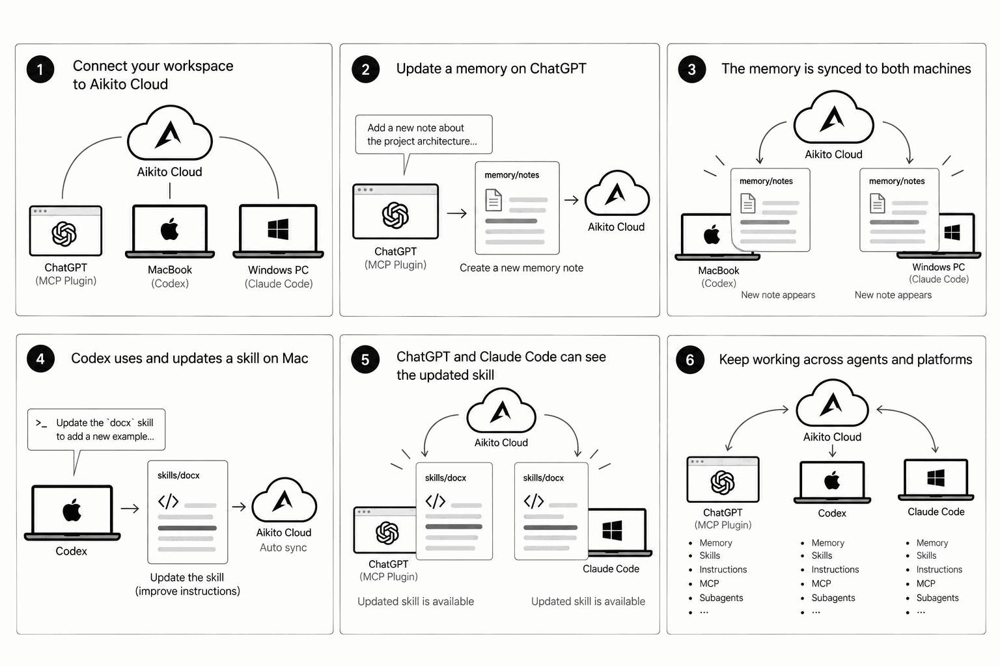

# Aikito Cloud

[简体中文](remote-sync.zh-CN.md)

!!! note "Synchronization options"
    Aikito uses Git for multi-machine synchronization by default and does not require
    a dedicated server. You can also develop your own synchronization server using
    the [Remote Protocol](architecture/remote-protocol.md), or use Aikito Cloud.
    This guide covers connecting to Aikito Cloud.

    Synchronizing with Aikito Cloud also requires the
    [encrypted runtime](installation.md#macos-linux-with-homebrew).

Connect your Aikito workspace to Aikito Cloud to keep your resources up to date
across machines. You need an Aikito Cloud account and the connection command
shown on your account page.



## Ask your agent

Give these requests to a local coding Agent with terminal access, such as Codex
or Claude Code. The Agent can inspect your workspace, run the setup commands,
and verify synchronization. You complete account sign-in, recovery-code entry,
and authorization confirmations yourself. If the Agent cannot keep an interactive
terminal open, it should hand you the connection command and resume after you
finish. Keep passwords and recovery codes out of the conversation.

### Set up Cloud synchronization

> Connect this machine's Aikito workspace to Aikito Cloud using the service
> address from my account page. Follow the [Cloud guide](remote-sync.md), check
> the active workspace and encrypted runtime, and reuse my existing workspace.
> Guide me through signing in and approving the device connection. Preview the
> first synchronization and explain any conflicts before applying it. Then
> synchronize, enable background synchronization, and verify the remote status.
> Report the recovery-code backup location without reading or printing the code.

### Connect another machine

> Set up Aikito Cloud on this new machine using my existing account and service.
> Follow the [Cloud guide](remote-sync.md), check the installation and workspace,
> and let me complete sign-in and enter the recovery code in the local terminal.
> Download my synchronized resources, enable background synchronization, then
> synchronize and verify the local Agent setup. Ask me for local project paths
> where needed, and explain any conflicts before resolving them.

### Make resources available to ChatGPT

> Help me connect ChatGPT to Aikito Cloud following the
> [MCP setup below](#connect-ai-clients-through-mcp). Verify that Cloud
> synchronization works and open the local console. Ask which resources I want
> to share and whether each needs read or write access. Guide me through resource
> authorization, local confirmation, and ChatGPT connection, leaving those
> approvals to me. Then help me verify access with a read-only lookup of a resource
> I selected. Do not request or display my recovery code.

The following sections provide the manual steps and completion checks for each
request. More examples are in [Agent Request Examples](agent-workflow.md).

## Connect your first machine

If you received an invitation, open its link and set your account password.
Otherwise, sign in with your existing account.

Use your existing Aikito workspace. If you have not created one, run:

```bash
aikito init workspace ~/aikito
```

Copy the connection command from your account page and run it in an interactive
terminal:

```bash
aikito remote bind https://aikito.notsonan.com
```

1. Open the link printed in the terminal if the browser does not open automatically.
2. Sign in, compare the connection code (such as `dc9b-4280`) with the terminal,
   and approve the connection you just started.
3. Return to the terminal. On the first connection, Aikito initializes encryption
   and saves your recovery code locally. It prints the saved file's location;
   no manual save confirmation is required.

Run your first synchronization:

```bash
aikito remote sync
```

This command applies changes. To inspect them first, optionally run
`aikito remote sync --dry-run` before synchronizing. Connecting alone does not
transfer resources or enable background synchronization.

The commands use your active workspace. If you manage more than one, add
`--workspace /path/to/workspace` to each `aikito remote` command.

## Keep changes synchronized automatically

Start background synchronization on each connected machine:

```bash
aikito remote start
aikito remote status
```

Check that status reports the background service as running. Changes synchronize
while the service is running and the machine can reach your service. Local work
remains available when offline; synchronization resumes when connectivity returns.

To pause background synchronization:

```bash
aikito remote stop
```

You can still synchronize manually with `aikito remote sync`.

## Connect another machine

Install a compatible Aikito client and initialize a workspace on the new machine:

```bash
aikito init workspace ~/aikito
aikito remote bind https://aikito.notsonan.com
```

Use the same service address and account. Approve the browser connection, then
enter your recovery code when the terminal asks for it. Aikito verifies the code,
keeps the device's decryption key, and saves a local copy of the recovery code.

Synchronize the existing content and enable background synchronization:

```bash
aikito remote sync
aikito remote start
```

After downloading, [synchronize and verify your local Agent setup](sync-existing-setup.md)
to connect the resources to the Agents installed on this machine.

Synchronization transfers Aikito-managed resources, not your projects' source
repositories. Clone project code separately and
[connect its local path](project-setup.md). You do not need to copy hidden local
state from the other machine.

## Connect AI clients through MCP

Aikito Cloud exposes synchronized content through a remote MCP endpoint. Complete
the first synchronization above before connecting an AI client. Synchronization
alone does not allow any AI client to read or change your resources.

!!! note "Supported clients"
    Currently, only ChatGPT can connect to Aikito Cloud. Other MCP clients cannot
    connect yet; support will be rolled out gradually.

### Choose the resources to share

On the connected machine that holds its decryption key, open the local console.
The browser connection already saves the service's public identity automatically;
you do not need to fetch a key or manage a separate public-key file.

```bash
aikito web
```

Use the same active workspace you connected. Keep the console running and open
**Resource Access**. Then:

1. Open your [Aikito Cloud account page](https://aikito.notsonan.com/account).
2. Under **Authorize collections**, select the resources to share. Choose **Read**
   for lookup, and **Write** only for resources you want an AI client to change. Select
   an authorization lifetime and click **Send for local confirmation**.
3. In the local console, review the account, service, selected resources,
   permissions, and lifetime, then confirm the request.
4. Check that the resources appear under **Authorized collections** online.

If the resource list is empty, open Resource Access locally to publish the
current list, then refresh the account page. Aikito Cloud can process the selected
resources for authorized AI clients; unselected resources remain unavailable.

### Connect ChatGPT

In ChatGPT on the web, open **Plugins**, use the plus button to add a custom MCP
server, and enter these Aikito Cloud settings:

| Setting | Value |
| --- | --- |
| Name | `Aikito Cloud` |
| Server URL | `https://aikito.notsonan.com/mcp` |
| Authentication | OAuth |
| Client ID | `aikito-chatgpt` |
| Client secret | Leave empty; this connection uses a public client |

Use the connection settings supplied by your service if they differ. Review
ChatGPT's connection notice and create the plugin, then complete its account
connection: sign in to the same Aikito Cloud account, select the resources and
permissions for this ChatGPT connection, and approve. Install the resulting
plugin if prompted. Resources must be authorized in Aikito before they can be
selected here; a ChatGPT connection cannot expand that authorization.

Account and workspace policies may limit this entry point. For the current UI
and installation steps, see OpenAI's
[custom MCP server guide](https://developers.openai.com/api/docs/guides/custom-mcp-server).
Never enter your Aikito recovery code in ChatGPT.

### Use or revoke access

In ChatGPT, start a conversation, type `@`, and select the Aikito Cloud plugin. Try:

> Use Aikito Cloud to find my notes about this project and summarize them.

For resources you allowed an AI client to edit, ask it to show the proposed changes
before you confirm them. Keep background synchronization running on your machines
to receive changes made through that client.

Your Aikito Cloud account page lists the connection under **Connected AI clients**.
Revoke it there to stop that AI client connection without disconnecting workspace
synchronization. Revoke a resource authorization under **Authorized collections**
to remove access to those resources for all AI clients using that authorization.
If resources are missing or access has expired, check both the resource
authorization and that connection's permissions before reconnecting.

## Local files and recovery

### Recovery code backup

The default file location on macOS and Linux is:

```text
~/.config/aikito/encrypted-remote/recovery.txt
```

If `XDG_CONFIG_HOME` is set, the file is under
`$XDG_CONFIG_HOME/aikito/encrypted-remote/recovery.txt`. On Windows it is under
`%APPDATA%\aikito\encrypted-remote\recovery.txt`, with `~/.config` as the fallback
when `APPDATA` is not set.

Open the file locally when you need to connect another machine. Each record
contains a recovery code plus the service address and workspace path where it
was saved. Use those labels to find the relevant `code:` value. Reusing the
same synchronization space updates its record rather than adding another copy.
The file is private to your user and stays outside the workspace and synchronization.

Keep a separate copy in a password manager or another safe location: a file on
this machine will not help if the machine itself is lost. Your account password
lets you sign in; it cannot replace a lost recovery code or decrypt your content.

Codes are saved when first generated or successfully entered during recovery.
Reconnecting an older device that only has its decryption key cannot reconstruct
a recovery code that was never backed up.

### Lost recovery code with an unlocked existing device

Normally, use the recovery code to connect another device. If the code is lost but
an existing device can still decrypt the space, transfer its matching file key
over SSH. No Cloud reset is needed:

1. On the existing device, run `aikito remote key inspect --workspace ~/aikito`
   and confirm success. Read `vault_id` from the workspace's
   `.local/state/aikito/encrypted-discovery.json`, then find the matching
   `encrypted-remote/keys/<vault_id>.key` in the user configuration directory
   (default: `~/.config/aikito`). Do not use `sync_id` or a test space's key.
2. If using native key protection, first run
   `aikito remote key storage --workspace ~/aikito --backend file`.
   A `.key` file can instead contain a machine-protected record that cannot be
   used on another machine. This command requires the original native store to be available.
3. Install Aikito and initialize a workspace on the new device. Transfer only the
   matching key over SSH to its corresponding configuration path. On macOS/Linux,
   use directory mode `0700` and file mode `0600`; Windows requires owner-only
   ACLs. Do not overwrite an existing key or copy all keys or account credentials.
4. On the new device, run `aikito remote bind https://aikito.notsonan.com` and
   authorize the same account, then run `aikito remote sync` and
   `aikito remote start`. A matching local key removes the need for the recovery code.

Protect the key like the recovery code; keep it out of Git, conversations, and
logs. If inspection fails or binding still requests a code, check paths, Vault
identity, and permissions before proceeding. Do not reset the existing space.
These examples assume the workspace is `~/aikito`.

### Service public key

The browser connection automatically saves the service's public key and identity
record. The default location on macOS and Linux is:

```text
~/.config/aikito/remote-recipients/<service-origin-hash>.json
```

The configuration-directory rules above also apply here for `XDG_CONFIG_HOME`
and Windows `APPDATA`. The filename is derived from the service address, and
Aikito manages it automatically; no manual key-fetch command or file selection
is needed. This is public service identity information, distinct from your secret
recovery code. A changed service key is rejected rather than silently replacing
the saved identity. Resource access still requires the separate approval above.

## Reconnect or disconnect

If an account password reset invalidates your device connection, reconnect with:

```bash
aikito remote bind https://aikito.notsonan.com --rebind
```

Aikito reuses your account's existing synchronized content. If this machine still
has its decryption key, it normally does not ask for the recovery code again.

To disconnect the workspace and stop its background synchronization:

```bash
aikito remote unbind
```

Disconnecting preserves local resources and the content stored by your account.
For command options, see the [CLI reference](cli-reference.md#remote-store-synchronization).
For a Git-based workspace transfer, see
[Connect a Workspace on Another Machine](workspace-portability.md).
